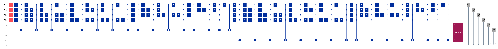
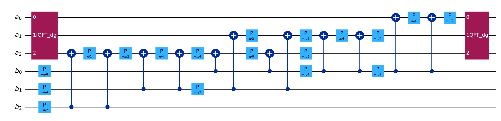
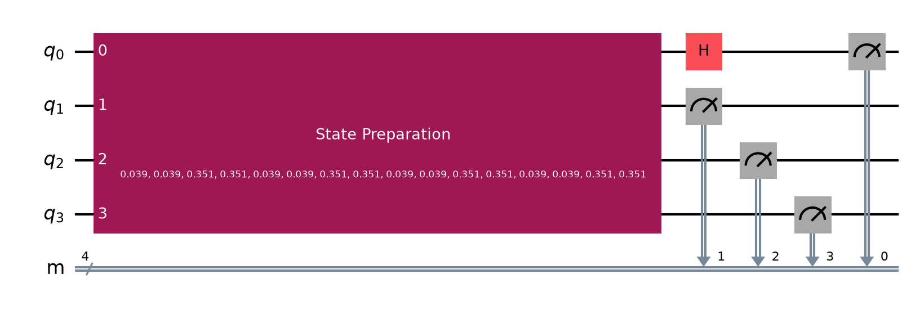
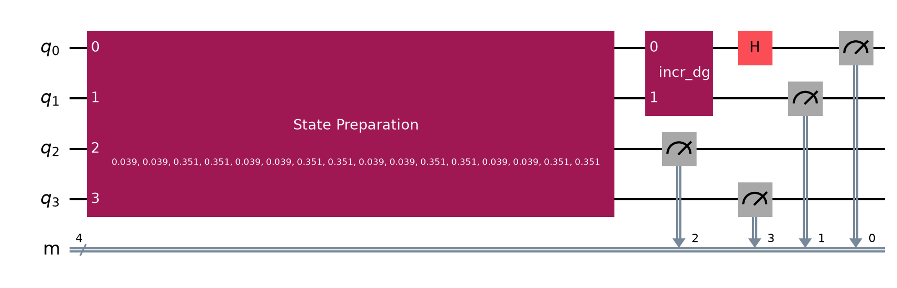

# Architecture

How this project is put together, end to end. Read this if you want to know what each piece does, which gates show up, and how a greyscale image turns into an edge map on a quantum circuit.

For the short story and plots, see the [README](README.md). For numbers, see [`results/summary.json`](results/summary.json).

---

## What we are trying to show

Two quantum edge detectors get claimed as exponentially faster than classical `O(N)` methods:

1. **NEQR** edge detection (basis encoding + arithmetic)
2. **QHED** (amplitude encoding + Hadamard differencing)

Those claims usually skip two costs that still scale with the image:

* **State preparation** (loading the pixels onto the qubits)
* **Readout** (enough shots to reconstruct the full edge map)

This repo implements both detectors in Qiskit, runs them on the same images, sweeps shots and noise, and scores them with F1, SSIM, and resource counts. Classical Sobel / Canny are the ground truth.

---

## Big picture

```
                    .env / config.py
                           |
                           v
   images.py  --->  detectors.py  --->  metrics.py  --->  experiments.py
   (inputs)         (NEQR / QHED)       (F1, SSIM,          (shot / noise /
                     |                   resources)          size sweeps)
                     |
                     +-- neqr.py + arithmetic.py
                     +-- qhed.py
                     +-- simulate.py + noise.py  (Aer, optional noise + mitigation)
                           |
                           v
                      results/*.csv
                      results/*.png
                      results/summary.json
```

CLI entry point: `qedge` ([`src/qedge/cli.py`](src/qedge/cli.py)). Experiments land in `results/`.

---

## Stack

| Piece | Role |
|---|---|
| Python 3.12 | Runtime (via `uv`) |
| Qiskit 1.x | Circuit construction |
| Qiskit Aer | Simulator (noise-free + noisy) |
| NumPy / SciPy | Arrays, dilation for F1 tolerance |
| scikit-image | Sobel, Canny, SSIM, BSDS500 / test images |
| Matplotlib + pylatexenc | Result plots and circuit drawings |
| python-dotenv | Loads [`.env`](.env) |
| pytest | Unit tests under `tests/` |

No cloud backends. Everything runs locally on Aer.

---

## Image pipeline

[`src/qedge/images.py`](src/qedge/images.py) builds square greyscale arrays in `[0, 1]`. Side length is a power of two (4, 8, 16, 32). That constraint comes from the encoders: position indices need an integer number of qubits.

Three families, same sizes for both detectors:

1. **Synthetic** - step edge, square, disk, checkerboard. Crisp edges, good for sanity checks.
2. **Standard** - scikit-image greyscale (`camera`, `coins`, `moon`), center-cropped and resized.
3. **BSDS500** - natural scenes. Downloaded on demand into `data/`. If the download fails, the other two families still run.

NEQR also needs integer intensities. Detectors quantise to `q` colour bits: `round(pixel * (2^q - 1))`.

---

## Classical ground truth

[`src/qedge/classical.py`](src/qedge/classical.py):

* **Sobel** - continuous gradient magnitude, normalised to `[0, 1]`. Used for SSIM.
* **Canny** - binary edges (falls back to thresholded Sobel on tiny images).
* **Otsu binarise** - turns any magnitude map into a binary mask for F1.

F1 uses a 1-pixel matching tolerance (BSDS-style), so a predicted edge one pixel off the ground truth still counts.

---

## Gates you will see

Plain English for the gates that show up in the drawings.

| Gate / block | What it does here |
|---|---|
| **H** (Hadamard) | Puts a qubit into equal superposition. On position qubits: visit every pixel. On QHED's axis LSB: turn neighbour amplitudes into sum / difference. |
| **X** | Bit flip. Used to flip control lines so multi-controlled gates fire on the right pixel address. |
| **CX / MCX** | Controlled-NOT / multi-controlled-NOT. NEQR uses these to write colour bits when the position matches a pixel. |
| **CP** (controlled phase) | Phase kickback inside the Draper adder / subtractor. |
| **QFT / IQFT** | Quantum Fourier Transform and its inverse. The Draper block does arithmetic in the Fourier basis. |
| **prepare_state** | Qiskit's amplitude loader. QHED packs the whole image into one state vector. |
| **incr / incr_dg** | Binary incrementer and its inverse (decrement). QHED's odd pass shifts which pixel pairs the Hadamard sees. |
| **Measure** | Collapses qubits into classical bits. You need many shots to fill the edge map. |

Circuit PNGs live in `results/` and are redrawn with `uv run python scripts/draw_circuits.py`.

---

## Detector 1: NEQR

Code: [`src/qedge/neqr.py`](src/qedge/neqr.py), arithmetic in [`src/qedge/arithmetic.py`](src/qedge/arithmetic.py).

### Encoding

For an image of size `2^n × 2^n` with `q` colour bits:

```
|I⟩ = (1 / 2^n)  Σ_{y,x}  |c(y,x)⟩ |y⟩ |x⟩
```

Registers:

* `px`, `py` - `n` qubits each (pixel address)
* `c1`, `c2` - `q` qubits each (this pixel and its neighbour)

Total qubits for the edge circuit: `2n + 2q`.

### How the image gets loaded

1. Hadamard every position qubit. Uniform superposition over all `(x, y)`.
2. For each pixel with non-zero intensity, flip the position controls that should be `|0⟩` into `|1⟩`, fire multi-controlled-X gates onto the colour bits that should be set, then unflip. That is the expensive part. Gate count grows with the number of non-zero colour bits across the image.

We do that twice: once for the original image into `c1`, once for a classically shifted neighbour into `c2` (right shift for horizontal edges, down shift for vertical). Boundaries clamp.

### Edge detection (Draper subtractor)

After both colour registers are loaded, a Draper QFT subtractor runs:

```
c1  ←  (c1 − c2)  mod  2^q
```

Inside the Draper block:

1. QFT on register `a` (`c1`)
2. Controlled-phase kicks from register `b` (`c2`) into `a`
3. Inverse QFT on `a`

The subtractor is just the adder run backwards. No ancilla qubits.

Then we measure `c1` (the difference) plus the position registers. Decode: for each visited `(x, y)`, take the most frequent measured difference, convert two's-complement to a magnitude, normalise. Horizontal + vertical maps combine as `sqrt(h² + v²)`.





### Why NEQR is heavy

Every pixel costs multi-controlled loads. At 16×16 with a few colour bits we already see ~98k CX after transpile. Deep circuits also soak up gate noise, which is why NEQR's F1 drops harder than QHED under the same noise model.

---

## Detector 2: QHED

Code: [`src/qedge/qhed.py`](src/qedge/qhed.py).

### Encoding (QPIE)

Flatten the image (row-major), normalise so amplitudes have unit length, load with `prepare_state`. Qubit count is only `2n` for a `2^n × 2^n` image. Index layout: low `n` qubits are `x`, high `n` qubits are `y`.

### Hadamard edge trick

A Hadamard on the least-significant qubit of one axis maps a pair of neighbour amplitudes:

```
(a_{2b}, a_{2b+1})  →  ((a_{2b}+a_{2b+1})/√2 , (a_{2b}−a_{2b+1})/√2)
```

Odd measurement outcomes carry the edge between that pair. That only covers even-odd boundaries. The **odd pass** applies a cyclic decrement on the axis first, so the pairing shifts by one pixel. Even + odd covers the full axis. We drop the wrap-around boundary (last pixel vs first), which is an artifact of the cyclic shift.

Four circuits per full edge map: horizontal even, horizontal odd, vertical even, vertical odd. Same shot budget on each.





### Decode

From counts, keep only odd-parity outcomes on the axis LSB. Convert frequencies to amplitudes (`sqrt(2 * count / shots)`), place them on the right boundary coordinates, normalise, combine H and V as `sqrt(h² + v²)`.

### Why QHED is lighter

Fewer qubits. Shallow after state prep. Under noise it holds F1 near 0.98 at the 2% depolarising level we swept. The catch: amplitude encoding means each shot samples from a probability distribution over all pixels, so reconstructing a clean map still needs a shot budget that grows with image size.

---

## Simulation and noise

[`src/qedge/simulate.py`](src/qedge/simulate.py) transpiles and runs circuits on Aer.

[`src/qedge/noise.py`](src/qedge/noise.py) builds a one-knob noise model from `level`:

* 1-qubit depolarising ≈ `level / 10`
* 2-qubit depolarising = `level` (on CX / CZ)
* thermal relaxation on 1q gates
* symmetric readout bit-flip ≈ `min(2 * level, 0.5)`

`level = 0` means noise-free.

**Readout mitigation.** Calibrate each measured bit with prepare-0 / prepare-1 circuits, invert the 2×2 response, and contract that against the probability vector (tensored, so no giant `2^k × 2^k` matrix). This helps readout error. It does little for NEQR's deep gate noise.

For small noisy circuits (≤13 qubits) Aer uses the exact `density_matrix` method. Larger ones fall back to trajectory sampling.

---

## Metrics and resources

[`src/qedge/metrics.py`](src/qedge/metrics.py):

* **F1** - precision / recall against classical edges, 1-pixel tolerance
* **SSIM** - quantum magnitude vs Sobel magnitude
* **Resources** - qubit count, logical depth/size, transpiled depth/size in basis `{rz, sx, x, cx}`, CX count, circuit count, total shots

End-to-end reports add up every circuit that went into one edge map (QHED's four passes, NEQR's two axes).

---

## Experiments

[`src/qedge/experiments.py`](src/qedge/experiments.py), driven by [`.env`](.env):

| Experiment | What it answers | Output |
|---|---|---|
| Shot sweep | How F1 / SSIM move with shot budget | `results/shot_sweep.csv` |
| Shot × size | Whether shots to high F1 grow with image size (`O(N)` readout) | `results/shot_size_sweep.csv` |
| Noise sweep | How much noise each method can take, with / without mitigation | `results/noise_sweep.csv` |
| Size / resources | Qubit and CX scaling | `results/size_sweep.csv` |

Figures: [`src/qedge/figures.py`](src/qedge/figures.py). Summary: `results/summary.json`.

NEQR is simulated through 16×16. At 32×32 the gate count gets ugly, so we treat that size as a resource projection for NEQR and still run QHED fully.

Adaptive colour depth keeps NEQR simulable:

| Size | Default colour bits |
|---|---|
| 4 | 8 |
| 8 | 6 |
| 16 | 4 |
| 32 | 2 (projection / skip if over bit budget) |

Noise sweeps often pin NEQR at 2 colour bits so the density-matrix simulator stays fast.

---

## Module map

```
src/qedge/
  config.py       load .env, paths, seed, sweeps
  images.py       synthetic / standard / BSDS500 loaders
  classical.py    Sobel, Canny, binarise
  arithmetic.py   Draper QFT adder / subtractor
  neqr.py         NEQR encode + neighbour-difference circuit + decode
  qhed.py         QPIE + Hadamard edge circuits + decode
  simulate.py     Aer transpile + run
  noise.py        noise model + tensored readout mitigation
  metrics.py      F1, SSIM, resource reports
  detectors.py    run_neqr / run_qhed end-to-end
  experiments.py  sweeps → CSV
  figures.py      plots + montage
  cli.py          qedge smoke|shots|noise|size|all|...
scripts/
  draw_circuits.py   circuit PNGs
  smoke.py           quick manual check
  finish.py          finish leftover sweeps
tests/               arithmetic, detectors, metrics, images, noise
```

---

## How to run it yourself

```bash
uv venv --python 3.12
uv sync --extra dev
uv run qedge smoke          # tiny correctness check
uv run qedge all --sizes 4 8
uv run python scripts/draw_circuits.py
uv run pytest
```

Knobs live in [`.env`](.env): seed, shot list, noise list, image sizes, BSDS500 toggle.

---

## Mental model for a third person

1. Pick an image. Resize to 8×8 (say).
2. Classical Sobel / Canny give the "truth" edges.
3. **QHED path:** pack pixels into amplitudes → Hadamard (and optional decrement) → measure many times → decode odd outcomes into an edge map.
4. **NEQR path:** superpose positions → load colours with multi-controlled-X → Draper-subtract neighbour → measure → decode differences.
5. Score both against the classical map. Count qubits, CX, shots.
6. Repeat while changing shot budget, noise level, and image size.

That loop is the whole project. The circuits are real Qiskit objects. The plots in the README are from that loop on this machine.
