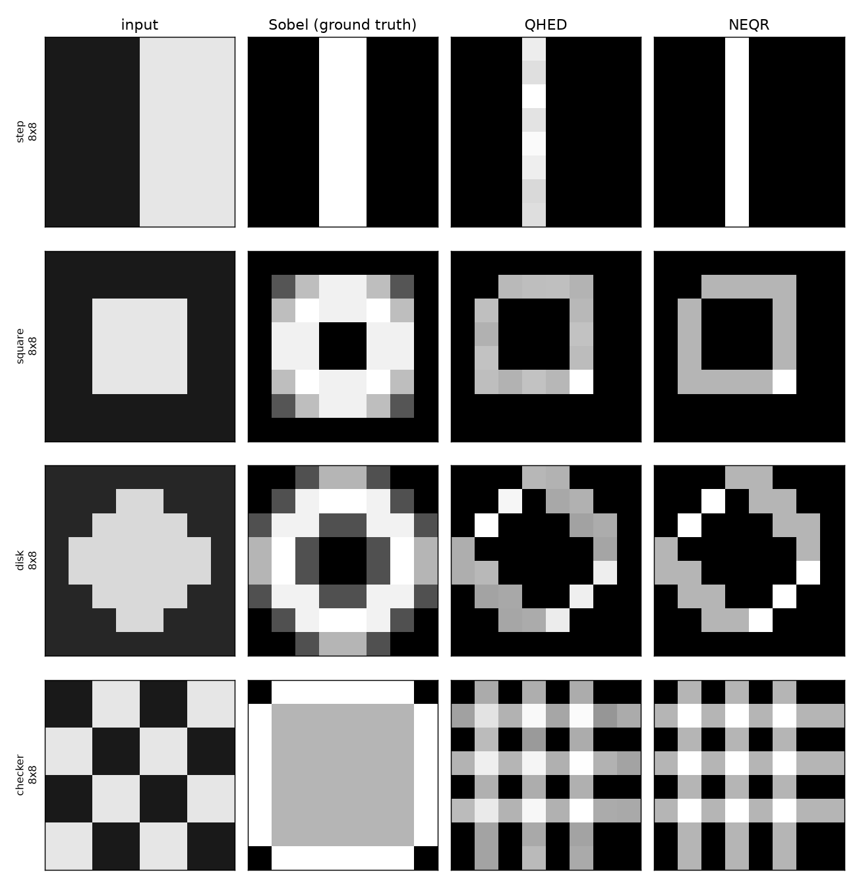
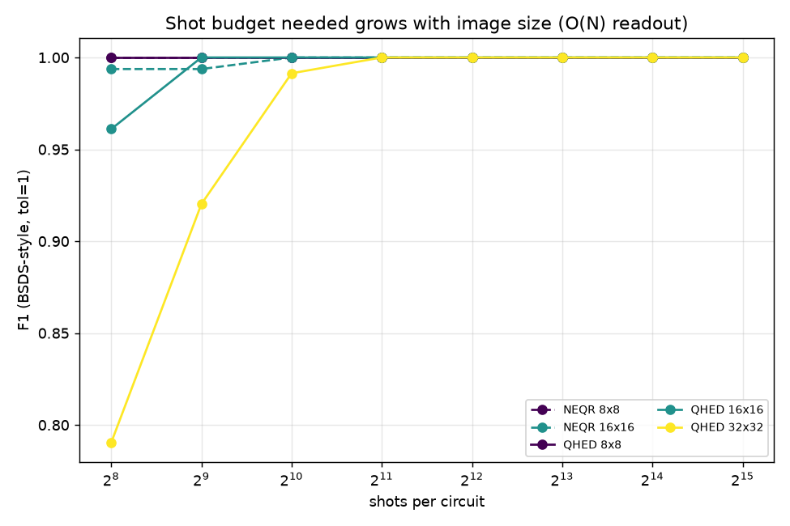
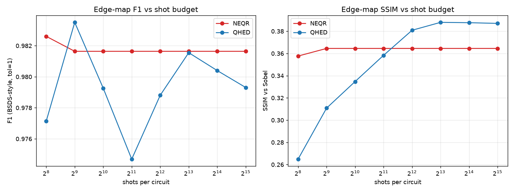
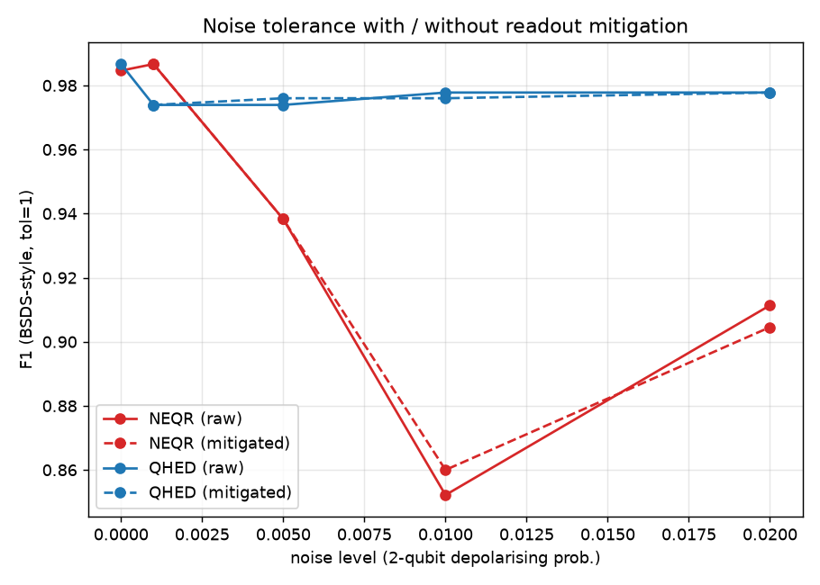
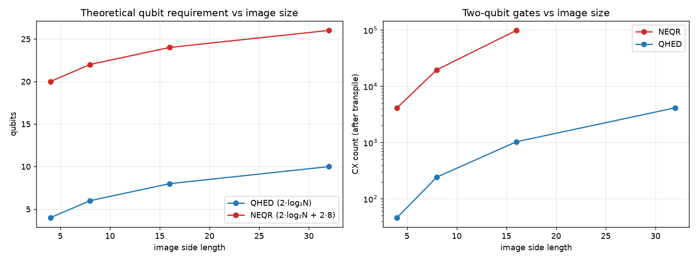

# QuantumComputing

**Quantum Image Edge Detection Using NEQR and QHED: accuracy, shot requirements and noise analysis.**

Papers on NEQR and QHED like to talk about exponential speed-ups against classical `O(N)` edge detectors. They usually skip the bill.

State preparation costs real gates. Getting a full edge map back still costs `O(N)` measurement shots. A lot of the published demos also stop at noise-free sims or at 2×2 / 4×4 hardware runs, and the two methods almost never sit on the same images with the same metrics.

This repo wires both detectors in Qiskit, feeds them the same 4×4 to 32×32 greyscale and BSDS500 images, sweeps shot counts, and runs a realistic Aer noise model with readout mitigation. We score with F1, SSIM, and end-to-end resource counts (qubits, two-qubit gates, depth, total shots). The question we actually answer is how many shots each method needs, and how much noise it can take, before the edge map falls apart.

---

## What we found

Numbers come from [`results/summary.json`](results/summary.json) and the figures below. Re-run with `qedge all`.

**Qubits.** QHED (QPIE / amplitude encoding) needs `2·log₂(N_side)` qubits: **4, 6, 8, 10** as the side goes 4→32. NEQR (basis encoding) needs `2·log₂(N_side) + 2q`. At `q=8` that is **20, 22, 24, 26**, because the neighbour difference uses two colour registers. QHED wins on qubit count by a lot.

**State prep.** NEQR's multi-controlled loads pile up fast: **4.1k → 19.6k → 98.5k CX** from 4×4 to 16×16. QHED stays at **46 → 242 → 1030 → 4146 CX** for 4→32. That gate blow-up is the cost the asymptotic claims rarely price in.

**Shots.** For QHED, shots to hit **F1 ≥ 0.99** grow with size: **256 (8×8) → 512 (16×16) → 1024 (32×32)**. Side length doubles, shot budget roughly doubles. NEQR can look cheap per pixel on clean shapes, but it still has to visit all `O(N)` positions and it still pays the gate tax above.

**Noise.** At 2% two-qubit depolarising noise, QHED holds **F1 = 0.978**. Deep NEQR falls to about **0.91**. Tensored readout mitigation barely moves NEQR (**~0.905** either way). The damage is mostly gate error from circuit depth.

---

## Results

### Qualitative edge maps

Same 8×8 synthetic inputs. Columns: input, Sobel ground truth, QHED, NEQR.



### Shot budget vs image size

Bigger images need more shots for the same F1. That is the readout bottleneck.



### Accuracy vs shot budget

Mean F1 and SSIM across the benchmark, plotted against shots per circuit.



### Noise tolerance

F1 under depolarising + readout noise, raw and mitigated. QHED sits near 0.98. Deep NEQR drops, and mitigation barely rescues it.



### Resource scaling

Theoretical qubit counts next to transpiled two-qubit-gate counts, by image size.



Full numeric dump: [`results/summary.json`](results/summary.json).

---

## Methods

### NEQR (basis encoding)

A `2ⁿ × 2ⁿ` image lives as

```
|I⟩ = (1/2ⁿ) · Σ_{y,x} |c(y,x)⟩ |y⟩ |x⟩
```

A `q`-bit colour register holds each pixel's exact intensity in the computational basis. Loading the image means multi-controlled-X groups, one group per pixel. That is where the gate count goes.

For a horizontal gradient we wire two colour registers to the same position register: `c1 = I(y,x)` and `c2 = I(y,x+1)`. The neighbour image is a classically shifted copy (still a valid NEQR state). A Draper QFT subtractor does `c1 ← (I(y,x) − I(y,x+1)) mod 2^q`. Measure position plus `c1` and you get the neighbour difference at that pixel. Vertical edges use a vertically shifted copy. Boundaries clamp (edge-replicate). Code: [`src/qedge/neqr.py`](src/qedge/neqr.py), [`src/qedge/arithmetic.py`](src/qedge/arithmetic.py).

### QHED (amplitude encoding)

The whole image sits in the amplitudes of one `2·log₂(N)`-qubit register (QPIE). A Hadamard on the least-significant qubit of an axis turns neighbour amplitudes into sum / difference:

```
(a₂ᵦ , a₂ᵦ₊₁)  →  ( (a₂ᵦ + a₂ᵦ₊₁)/√2 , (a₂ᵦ − a₂ᵦ₊₁)/√2 )
```

Odd outcomes carry `|a₂ᵦ − a₂ᵦ₊₁|`. A cyclic decrement before the Hadamard shifts which pair gets measured, so the even and odd passes cover the in-between boundaries. We drop the wrap edge between the last pixel and the first. Code: [`src/qedge/qhed.py`](src/qedge/qhed.py).

### Classical ground truth and metrics

* Ground truth: Sobel gradient magnitude and Canny binary edges ([`src/qedge/classical.py`](src/qedge/classical.py)).
* **F1**: BSDS-style boundary F-measure, 1-pixel match tolerance.
* **SSIM**: quantum edge-magnitude map vs Sobel magnitude.
* **Resources**: qubits, logical/transpiled depth and size, CX count after transpile to `rz, sx, x, cx`, circuit count, total shots ([`src/qedge/metrics.py`](src/qedge/metrics.py)).

### Noise and mitigation

`build_noise_model(level)` in [`src/qedge/noise.py`](src/qedge/noise.py) is one knob: 1q/2q depolarising, thermal relaxation, symmetric readout error. `ReadoutMitigator` calibrates a tensored (per-qubit) readout correction and applies each qubit's inverse 2×2 response to the probability vector. No dense `2ᵏ×2ᵏ` matrix.

---

## Install and run (uv)

```bash
# 1. Create the environment (Python 3.12) and install everything
uv venv --python 3.12
uv sync --extra dev

# 2. Sanity check
uv run qedge smoke

# 3. Individual experiments (CSVs land in results/)
uv run qedge shots --sizes 4 8
uv run qedge noise --sizes 8
uv run qedge size  --sizes 4 8 16 32

# 4. Full benchmark + figures + results/summary.json
uv run qedge all --sizes 4 8

# 5. Tests
uv run pytest
```

Seed, shot/noise sweeps, image sizes, and the BSDS500 toggle live in [`.env`](.env). [`src/qedge/config.py`](src/qedge/config.py) loads them.

BSDS500 downloads into `data/` on first use. If that fails, the pipeline keeps going on synthetic images plus the scikit-image greyscale set.

---

## Repository layout

```
src/qedge/
  config.py       # .env-driven configuration
  images.py       # synthetic + standard + BSDS500 image sources
  classical.py    # Sobel / Canny ground truth
  arithmetic.py   # Draper QFT adder / subtractor
  neqr.py         # NEQR encoding + neighbour-difference edge detector
  qhed.py         # QPIE encoding + Hadamard edge detector
  noise.py        # Aer noise model + tensored readout mitigation
  simulate.py     # Aer run wrapper
  metrics.py      # F1, SSIM, resource reports
  detectors.py    # end-to-end NEQR / QHED pipelines
  experiments.py  # shot / noise / size sweeps -> CSV
  figures.py      # plots + qualitative montage
  cli.py          # `qedge` command-line entry point
tests/            # pytest suite (arithmetic, detectors, metrics, images, noise)
scripts/          # smoke.py and helpers
results/          # CSVs, figures, summary.json (generated)
data/             # BSDS500 (downloaded) + cache
```

---

## Limits

NEQR state prep with full multi-controlled loads grows so fast that we simulate NEQR through **16×16** and treat **32×32** as a resource projection. QHED runs at every size we plot.

The "exponential" win is in qubit count. Reading an N-pixel edge map still costs `O(N)` shots for both methods. That is the finding we care about.

The noise model is a stand-in, not a fitted copy of one backend. Mitigation is tensored, so it assumes independent readout errors.

## References

* Zhang et al., *NEQR: a novel enhanced quantum representation of digital images* (2013).
* Yao et al., *Quantum image processing and its application to edge detection* (QHED), Phys. Rev. X (2017).
* Arbeláez et al., *Contour Detection and Hierarchical Image Segmentation* (BSDS500), IEEE TPAMI (2011).

## License

MIT.
